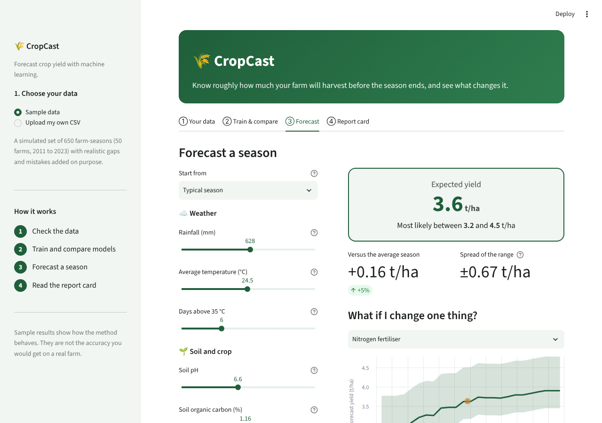
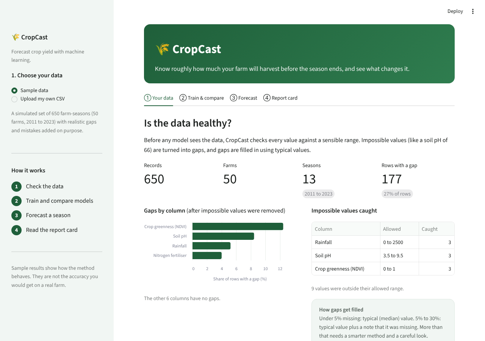
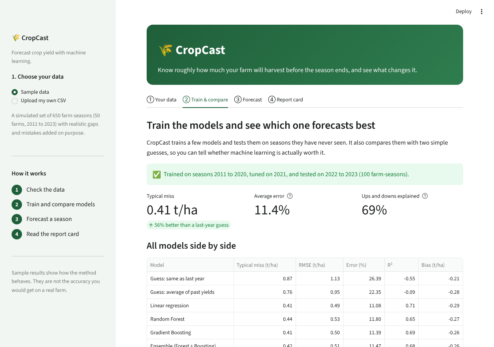
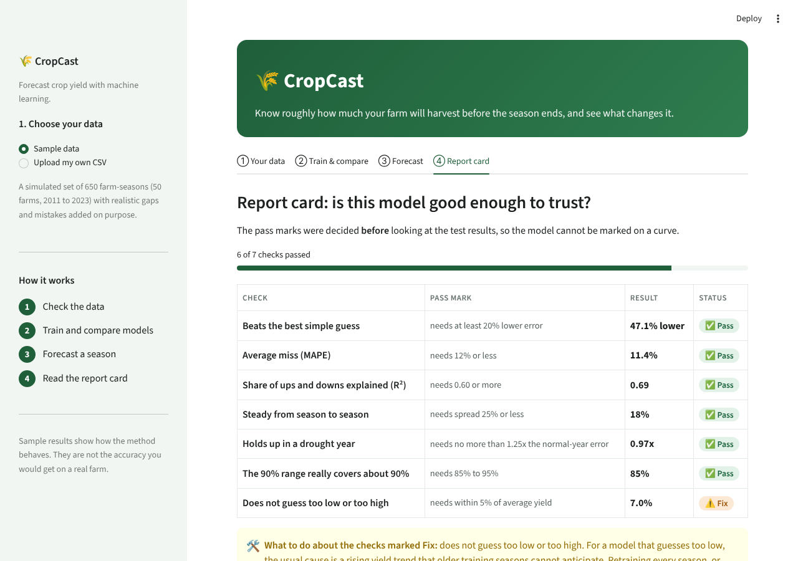
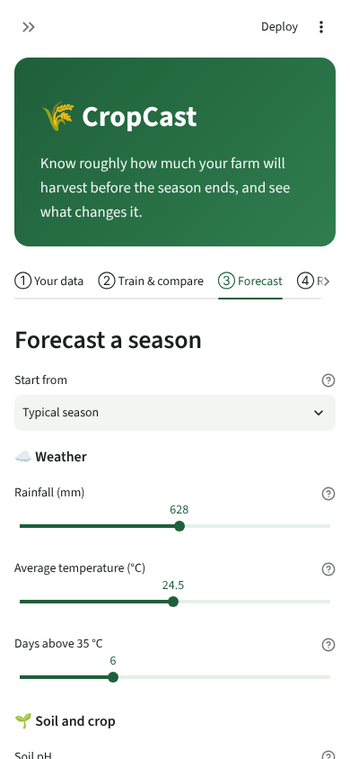

# 🌾 CropCast

**Forecast crop yield with machine learning, in a web app anyone can use.**

CropCast is the working project behind my Week 4 internship report, *Predictive Modeling Framework for Agricultural Yield Forecasting*. The report describes the method. This project is the method, running: you can check your data, train and compare models, forecast a season with sliders, and see whether the model is good enough to trust.

> **A note on the data.** The sample dataset is simulated. I generated it to behave like real farm records (more water and fertiliser raise yield, heat lowers it) because I did not have access to real farm data. The results show how the method behaves, not the accuracy you would get on a real farm. You can upload your own CSV to try it on real records.

## What you can do in the app

| Step | What happens |
|---|---|
| **① Your data** | Every value is checked against a sensible range (a soil pH of 66 is caught). Gaps are shown and filled in. |
| **② Train & compare** | Four models are trained and tested on seasons they have never seen, next to two simple guesses, so you can see whether machine learning is actually worth it. |
| **③ Forecast** | Move the sliders (rain, heat, soil, fertiliser...) and get an expected yield with a likely range. A "what if I change one thing?" chart shows, for example, how yield responds to more nitrogen. You can also upload a CSV to forecast many farms at once. |
| **④ Report card** | The model is marked against pass marks that were set before looking at the test results, and it says plainly where it falls short. |

<p align="center">
  
</p>

<details>
<summary>More screenshots</summary>

**Data check**



**Train and compare**



**Report card**



**On a phone**


</details>

## Quick start

You need Python 3.10 or newer.

```bash
# 1. Get the code
git clone https://github.com/<your-username>/cropcast.git
cd cropcast

# 2. (Recommended) make a clean environment
python -m venv .venv
source .venv/bin/activate          # on Windows: .venv\Scripts\activate

# 3. Install
pip install -r requirements.txt

# 4. Start the app
streamlit run app/streamlit_app.py
```

Your browser opens at `http://localhost:8501`. Click **Train models** on step ②, then try the sliders on step ③.

Just want the numbers from the report, without the app?

```bash
python run_experiment.py
```

## Using your own data

Choose **Upload my own CSV** in the sidebar. The file needs one row per farm per season, with these columns (the sidebar has a downloadable template):

`year, farm, rainfall_mm, avg_temp_c, heat_days, soil_ph, soil_oc_pct, nitrogen_kg_ha, irrigation_mm, ndvi_peak, prev_yield, yield_t_ha`

- At least **6 different seasons** are needed. The last two seasons become the test set, the one before is used for tuning, and everything earlier is used for training.
- Gaps and impossible values are fine. They are detected and handled for you.
- If something is wrong with the file, the app tells you what, in plain words.

## How it works (short version)

1. **Check:** values outside their allowed range become gaps (`src/cropcast/validate.py`).
2. **Prepare:** gaps are filled with medians learned from the *training* seasons only, "was missing" flags are added, a few helpful features are built (total water, heat × temperature, soil pH distance from ideal), and extreme values are capped (`preprocess.py`).
3. **Train:** linear regression, Random Forest and Gradient Boosting, tuned on the validation season, plus an average of the two tree models (`models.py`).
4. **Judge:** MAE, RMSE, MAPE, R² and bias on the locked test seasons, a four-season walk-forward check, a drought-year stress test, a 90% prediction range, and the pass-mark report card (`evaluate.py`).

The split is always by **year**, never random, so the model is only tested on seasons that come after the ones it learned from. This mirrors real forecasting and avoids results that look better than they really are.

## Results on the sample data

| Model | RMSE (t/ha) | MAPE | R² | Bias (t/ha) |
|---|---:|---:|---:|---:|
| Guess: same as last year | 1.126 | 26.4% | -0.548 | -0.209 |
| Guess: average of past yields | 0.946 | 22.4% | -0.094 | -0.277 |
| Linear regression | 0.489 | 11.1% | 0.709 | -0.292 |
| Random Forest | 0.532 | 11.8% | 0.654 | -0.268 |
| **Gradient Boosting** | **0.500** | **11.4%** | **0.694** | -0.259 |
| Ensemble (Forest + Boosting) | 0.510 | 11.5% | 0.683 | -0.263 |

Gradient Boosting passes 6 of 7 checks. The one it fails is **bias**: every model guesses about 0.26 t/ha too low on average (7.0% of mean yield, against a 5% limit). The likely cause is that yields rise over time, which models trained on older seasons cannot fully anticipate. Retraining every season is the first fix to try. Plain linear regression also does almost as well as Gradient Boosting here, because the features already capture the curved relationships.

## Project layout

```
cropcast/
├── app/streamlit_app.py      # the web app
├── src/cropcast/
│   ├── config.py             # ranges, labels, pass marks (one place for all settings)
│   ├── data.py               # builds the simulated dataset
│   ├── validate.py           # range checks
│   ├── preprocess.py         # gap filling, features, capping (no leakage)
│   ├── models.py             # the models and their tuning
│   ├── evaluate.py           # metrics, prediction range, report card
│   └── pipeline.py           # runs everything; Forecaster for new predictions
├── tests/                    # 18 tests (pipeline numbers, leakage, app end to end)
├── data/synthetic_yield_data.csv
├── docs/                     # screenshots and the Word report
├── run_experiment.py         # reproduces the report's numbers in the terminal
└── requirements.txt
```

## Run the tests

```bash
python -m pytest -q
```

The tests check, among other things, that all 9 planted data mistakes are caught, that the imputation uses training rows only, that the pipeline reproduces the numbers in the report, and that the app works from first click to forecast.

## Limitations

- The sample data is simulated. Repeat the analysis on real records before relying on any forecast.
- The test set is small (100 farm-seasons from two seasons), which is enough to compare models but not to say much about rare events.
- The 90% range covers the real yield about 85% of the time on the sample data, a little under target.
- Only seasonal summaries are used. Daily weather, growing degree days and soil nutrients are natural next additions.

## Report

The full written report is in [`docs/Week4_Predictive_Modeling_Report.docx`](docs/Week4_Predictive_Modeling_Report.docx).

## License

MIT. See [LICENSE](LICENSE).
